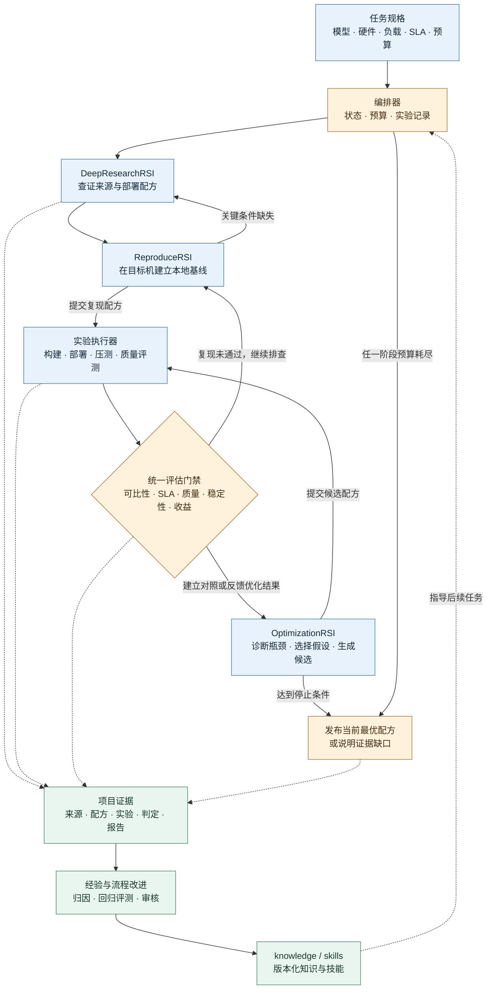

# BestPracticesRSI 架构设计

给定模型版本、目标硬件、负载和 SLA，交付一套能在目标机重建的部署方案，并用本地对照实验说明它在哪些场景下优于哪些基线。项目的结论以「模型 × 硬件档 × 负载档 × SLA 档」为单位。同一硬件上的不同卡数、拓扑或模型变体分别评估。

## 1. 整体框架图



[下载框架图 SVG](assets/framework.svg)

编排器维护统一的任务状态和预算。三个 RSI 模块依次交接证据与候选方案。复现和优化共用执行器及评估规则，复现测量用于建立基线，优化测量用于决定是否晋升候选。

## 2. 目录结构

```text
BestPracticesRSI/
├── README.md
├── framework.md
├── assets/                          # 架构图导出版
├── DeepResearchRSI/                 # 调研接入、来源归一、部署配方提取
├── ReproduceRSI/                    # 条件对齐、部署复现、外部指标比对
├── OptimizationRSI/                 # 瓶颈诊断、假设排序、候选配置生成
├── core/
│   ├── orchestrator/                # 状态机、预算、队列、检查点
│   ├── contracts/                   # 跨模块数据契约及版本
│   ├── runner/                      # 资源租约、容器生命周期、探针、产物采集
│   ├── evaluators/                  # 可比性、SLA、质量、收益及发布判定
│   └── evolution/                   # 经验归纳、流程回归、版本晋升
├── policies/                        # 默认 SLA、预算与发布策略
├── knowledge/
│   ├── confirmed/                   # 已验证且注明适用条件的经验
│   ├── failures/                    # 失败表现、证据与复现条件
│   └── hypotheses/                  # 待验证的跨项目线索
├── skills/                          # 按目录存放 SKILL.md、脚本和对应回归样例
├── tests/                           # 契约、编排恢复、评估和流程回归
└── projects/
    └── pro6000se/
        ├── hardware/                # 机器清单、PCIe/NUMA、P2P 探测结果
        ├── wikis/                   # 硬件平台说明、适配记录、跨模型操作手册
        └── deepseek-v4.1-flash/
            ├── task.yaml            # 目标模型、硬件档、负载档及政策引用
            ├── research/            # 来源、外部主张、差异表、待复现配方
            ├── docker/              # 镜像定义、构建脚本、依赖锁定
            ├── kernels/             # 内核补丁、构建参数、正确性验证
            ├── configs/             # 本地基线和候选的可执行部署配置
            ├── benchmarks/          # 请求集、长度/到达率矩阵、压测定义
            ├── quality/             # 质量样本、评分器、最低标准和容差
            ├── runs/                # 每次运行的清单、日志、指标和产物索引
            └── reports/             # 复现差异、优化判定、最终报告与发布清单
```

这是拟建目录。沿用 README 的三阶段命名和实验分类，将 `knowleges` 统一为 `knowledge`，并按硬件平台和模型两级归档。机器事实归 `hardware/`，解释和操作手册归 `wikis/`，模型专属实验归模型目录，跨项目可检索结论归 `knowledge/`。同一事实用路径和 ID 引用。大体量原始产物可放外部存储，`runs/` 中保留可访问位置和校验值。

两个现有上游项目通过适配器接入并锁定版本。DeepResearchRSI 已使用来源、证据和主张组织研究留档，可据此转换部署配方。ReproduceRSI 已提供条件与指标的离线比对原型，目标机调度、容器部署、压测和评测由本项目的执行器接入。 [DeepResearchRSI](https://github.com/taishan1994/DeepResearchRSI) · [ReproduceRSI](https://github.com/taishan1994/ReproduceRSI)

## 3. 阶段职责与交接

| 阶段 | 主要动作 | 交接产物 |
| --- | --- | --- |
| 任务定义 | 采集目标机规格，冻结模型、工作负载、评估规则和预算 | `TaskSpec`、硬件探测清单 |
| DeepResearchRSI | 按模型、硬件和工作负载拆问题，组合代码仓库、模型卡、官方文档和公开实测，去重并查证 | `ResearchBundle`，含来源、主张、配置、可比等级与证据缺口 |
| ReproduceRSI | 核对外部配方和目标机的差异，锁定依赖，启动并测量可执行方案 | `ReproductionReport`、可执行配方、本地 `baseline_id` |
| OptimizationRSI | 对本地瓶颈提出可证伪假设，逐轮变更、筛选、确认 | `CandidateSpec`、实验记录、评估判定 |
| 汇总发布 | 按冻结的场景矩阵选优，生成重建和回滚指引 | `ReleaseManifest`、最佳实践报告 |

### 最小数据契约

| 对象 | 必填内容 |
| --- | --- |
| `TaskSpec` | 模型仓库与 revision、权重/量化、tokenizer 与模板版本、GPU 型号/卡数/拓扑/资源上限、负载矩阵与主场景、SLA 策略、质量阈值、基线选择规则、预算、随机种子 |
| `ResearchBundle` | 每项主张的来源 URL、版本或访问日期、证据定位、条件及匹配度、冲突和缺失项、候选配方 |
| `Recipe` | 镜像 digest、框架与依赖版本、模型引用、补丁 hash、部署参数、启动/健康检查/停止命令 |
| `CandidateSpec` | 父配方 ID、变更项、目标瓶颈、预期收益、可能回归、验证矩阵与资源估算 |
| `RunRecord` | 任务版本、运行及配方 ID、实际环境指纹、请求集与测量协议版本、重复轮次、退出原因、逐请求指标及日志索引 |
| `Decision` / `ReleaseManifest` | 评估策略版本、候选及对照运行 ID、门禁结论、适用场景、配方/镜像/产物校验值、回滚版本 |

各对象包含 `schema_version`。冻结后的任务、配方和运行用不可变 ID 引用。环境指纹至少覆盖驱动、GPU 卡数及拓扑、软件版本、资源限制和运行时实际参数。修改模型语义、资源约束、负载或评估口径时创建新任务版本，重新建立可比基线。

## 4. Loop 设计

### 4.1 调研循环

1. 按 GPU 型号、卡数、模型 revision、权重量化、框架版本和负载列出待核对问题。召回相关项目经验，补充检索词和已知失败路径。
2. 分批检索并归一来源。AI 调研结果作为入口，每个关键数字、部署参数和结论回到原始证据。用条件矩阵将来源标成「条件匹配」「部分匹配」「参考线索」，对冲突并列记录。
3. 按可部署性和证据强度排复现优先级。配方可执行或调研预算用完时交接，同时保留缺口。复现发现关键参数未知时，只回补对应问题。

### 4.2 复现循环

1. 对齐 GPU、拓扑、镜像、模型和工作负载。标注关键条件是明确、推导、假设、未知还是冲突，保存来源及目标机实测值。
2. 用固定配方部署，依次通过启动、API、长上下文与所需 Tool Calling 冒烟。按预定条件和容差重复测量，记录「条件匹配的复现」「近似复现」「未复现」或「证据不足」。
3. 外部数据用于检查量级与差异。项目发布所用的对照是目标机上通过质量和 SLA 门禁的实测配方。对有竞争力的外部配方进行本地比较，按预先约定的规则为每个场景锁定初始基线。外部条件不足时，可建立明确标注来源的本地参考基线，并收窄比较结论。
4. 失败时按原因处理。瞬时基础设施故障限次重试，环境或依赖差异回查配方，负载或测量协议错误修正后重跑对照。若该场景缺少合格基线，但已有可部署且通过质量门禁的配方，可限预算搜索首个 SLA 达标方案，只记录绝对指标，相对提升标为不可计算。

### 4.3 优化循环

1. **观察。** 用基线分解排队、prefill、decode、通信和显存瓶颈。结合请求长度、并发、GPU 利用率、KV cache、调度和 kernel profile 形成可验证假设。
2. **排序。** 按预期收益、证据、资源开销和回归风险选下一项。优先改一个因素，需要联动的改动记录为组合，并用消融验证贡献。候选去重以配方内容、环境、负载和测试协议为键，显式的重复测量保留独立运行 ID。
3. **筛选。** 用启动和质量冒烟、小流量和短压测淘汰无效候选。候选消耗 GPU 时、运行次数及墙钟预算，筛选结果只用于决定是否进入确认。
4. **确认。** 在相同资源和请求协议下交替重跑候选、当前最优和锁定基线，覆盖主场景、必测场景及保留场景。达到门禁且显著优于当前最优才更新对应场景的最优配方。锁定基线继续用于计算对外累计提升。
5. **收敛。** 把失败、代价和收益写入实验记录。预算耗尽、候选用尽、达到任务目标或连续若干轮无确认收益时收尾。连续未改善轮数和最低有意义收益在任务开始时设定。
6. **归档与清理。** 项目收尾时，先归档最终报告、锁定配方、对照与候选的关键测量、评估判定，以及有复用价值的失败证据。核验归档清单、校验值和报告引用后，仅在当前项目的产物目录内删除可重建的缓存、临时文件和已有校验副本的重复产物。保留支撑结论或复现所需的唯一原始数据，保留用途尚未确定的文件。将删除路径、原因和释放空间写入 `reports/` 的清理记录，完成后再关闭任务。

### 4.4 跨项目的改进循环

项目收尾时从成功和失败中提取经验，记录适用范围、干预项、观测结果、证据 ID 和失效条件。可疑关联先作为假设，经过可比实验才提升为确认经验。发现跨任务重复出现的流程问题时，可提出检索策略、诊断脚本或技能的变更。

技能和策略候选使用固定的历史回放集以及独立保留样例验证。按检索覆盖率、复现成功率、误判率、找到合格方案所用 GPU 时等指标评估，并检查评估规则与基线是否被意外改变。通过回归及审核后发布版本，下一任务显式选用。运行中的任务继续使用其锁定版本，出问题可按版本回退。

### 4.5 状态、预算与恢复

- 任务主状态为 `planned → researching → reproducing → optimizing → reporting → completed`。复现缺条件可回到 `researching`。资源或关键输入缺失进入 `blocked`，记录恢复条件。预算耗尽进入 `reporting`，报告交代已验证范围与缺口。
- 单次实验经历排队、预检、部署、测量、评估和终结。阶段交接先保存产物与校验值，再提交检查点。恢复时已终结运行直接引用，未完整提交的运行标为中断并保留日志。重试使用新运行 ID，记录父尝试并计入预算。
- 执行器按节点及 GPU 分配带心跳的独占租约，容器与监听端口带任务标签。回收租约前清理对应任务资源，避免遗留进程污染后续测量。对照和候选共享同一测量资源时顺序运行。
- 把搜索预算和确认预算分开。网络、节点抢占等瞬时故障可以限次重试，OOM、质量退化和性能回归记录为该条件下的结果。单次运行超时、总 GPU 时、墙钟时间与最大候选数均可在任务中配置。

## 5. 统一评估与发布

### 5.1 负载及测量口径

冻结输入长度、目标输出长度、请求内容与种子、到达率或并发、采样参数、EOS 策略、缓存冷热和计时规则。正式比较使用相同的负载档和计时边界。固定到达率的服务压测与固定并发的饱和度测试分开记录。固定输出性能集用于公平比吞吐，自然结束的质量集用于校验真实回答和 Tool Calling。

TTFT 从客户端提交请求计到收到首个生成 token，包含排队与传输。TPOT 用「末 token 到达时间减首 token 到达时间，再除以输出 token 数减一」。固定输出性能集要求至少两个输出 token。流式计时、token 计数及短输出处理随评测器版本冻结。预热请求不进入统计，正式发出的请求全部计入分母，超时、失败和未满足长度契约的请求均视为未达标。

| SLA 档 | TTFT 上限 | TPOT 上限 |
| --- | ---: | ---: |
| InferX Base | 2 s | 70 ms |
| InferX Pro | 1.5 s | 50 ms |
| InferX Max | 1 s | 30 ms |

每个请求需成功且同时满足所选 SLA 两项上限才计为达标。设计默认每个必测场景的达标请求占比至少 95%，并在任务中独立配置允许的错误率。默认主指标是有效输出吞吐，即达标请求的输出 token 总数除以正式测量时长。时长从首个正式请求发出到最后一个正式请求完成或超时，计入尾部排空。另报告达标请求数/秒、总输出 token/秒、TTFT 和 TPOT 的 P50/P95/P99、错误率及峰值显存。vLLM 的压测工具支持配置请求级 goodput 条件，可用逐请求记录按本项目协议统一重算。 [vLLM 压测文档](https://docs.vllm.ai/en/v0.11.1/cli/bench/serve/)

### 5.2 门禁与主张

1. **可比性。** 检查实际环境、资源档、工作负载、指标定义和策略版本。记录候选明确改变的因素，剩余对照条件必须一致。更换模型变体或硬件档时另立比较组。
2. **质量和稳定性。** 通过预定质量下限与相对基线容差，覆盖任务要求的正确性、长上下文和 Tool Calling。所有必测场景均通过 SLA、错误率和稳定性要求。记录 OOM、重启和资源峰值。
3. **收益确认。** 每组对照默认至少三轮有效的独立配对测量，正式轮数、最低请求样本量和区间算法在确认前锁定。每对用相同的请求种子，交替 A/B 与 B/A。按场景报告 `(候选有效吞吐 / 对照有效吞吐 - 1) × 100%` 及区间，相关请求以所在的测量轮次为单位处理。收益区间的下界须超过晋升阈值。样本或精度不足时，按预先登记的复测计划处理，预算不足则标为待确认。
4. **发布。** 用锁定配方在干净环境执行一次重建和冒烟验证。报告主场景、必测矩阵、合格基线、误差、失败条件、重建命令和回滚配方。收益等级按 README 阈值划分。用 5%、10%、20%、30%、50% 作分界，恰好到分界值归入更高档，负值归为退化。对外使用「领先」时，要求可比基线覆盖已找到的有竞争力方案，且主场景相对该场景锁定基线的收益下界达到 20%。只在确有证据的硬件、模型和负载范围内主张领先。各场景最优配方不同时按场景分别发布。

95% 达标率、配对重复次数、分界归属和领先主张门槛属于本框架的评估设计。任务开始前可按业务调整达标率与重复策略，并锁定后执行。

## 6. 首个项目如何落地

1. 在 `projects/pro6000se/hardware/` 采集实际卡数、PCIe/NUMA、P2P、驱动及资源限制，再在模型目录锁定 DeepSeek-V4.1-Flash 的权重 revision、量化和 tokenizer。按短请求、长上下文和带工具调用的场景确定负载与验收矩阵。
2. 把 README 中的 8 卡 SM120、FlashInfer EP8 和 DSpark 配方录入候选库。先核对实际 SKU、卡数、拓扑、模型版本与负载，再决定能否在本机复现。外部报告的数据作为研究证据保存，本地结果来自重新测量。 [8 卡部署配方](https://github.com/nguyenhoangthuan99/deepseek-v41-flash-sm120)
3. 先打通一条「锁定配方 → 部署 → 压测 → 质量评估 → 生成报告」的路径，用同一执行器复跑并锁定合格基线。调研和失败归因初期可由人审核，所有阶段使用同一数据契约。
4. 依据剖析结果挑一个可隔离变量。例如先确认是否受调度、通信或 decode 限制，再测试相应配置或 kernel。通过确认门禁后归档部署配方和证据。第二个模型接入时，用同一套契约检验哪些经验和技能可迁移。
