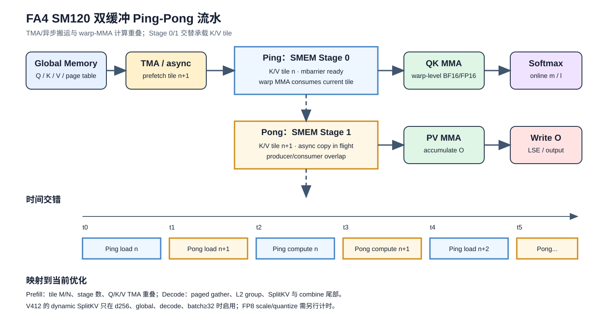

# FA4 SM120 Ping-Pong 图

图中 Ping/Pong 两个 shared-memory stage 交替承载 K/V tile：一个 stage 被 warp-MMA 消费时，另一个 stage 由 TMA/异步拷贝预取下一 tile。实际 kernel 还需要用 mbarrier、shared-memory fence 和 producer/consumer warp 协调可见性。
