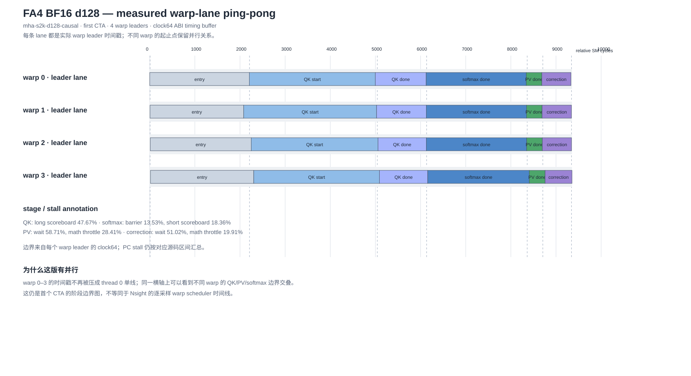

# SM120 FA4 Ping-Pong：NCU 回填报告

图已按截图的 lane 形式重画：现在使用 4 个 warp leader 的独立 clock64 时间戳绘制并行 lane，保留不同 warp 的边界交叠；右侧标出 SourceCounters stall。原始 warp timing：[fa4-sm120-warp-timing.json](fa4-sm120-warp-timing.json)。

这版不再把示意值当测量值。主图对应真实 NCU capture：`mha-s2k-d128-causal / ours / warm`。

## 真实采样

| 字段 | 实测值 | 来源 |
|---|---:|---|
| GPU | RTX PRO 6000 Blackwell Server Edition, SM120, 188 SM | NCU CSV / worker receipt |
| Kernel | `FlashAttentionForwardSm120` | NCU CSV |
| Kernel duration | 85,152 ns | NCU `gpu__time_duration.avg` |
| SM throughput / tensor active | 48.83% | NCU metrics |
| DRAM throughput | 0.86% | NCU |
| L2 hit | 100.00% | NCU |
| Effective SM clock | 2,280.25 MHz | NCU `sm__cycles_elapsed.avg.per_second` |
| Block / grid | `(128,1,1)` / `(32,16,1)` | NCU launch metrics |
| Registers/thread | 255 | NCU launch metrics |
| Shared memory/block | 82,944 B | NCU launch metrics |
| Waves/SM | 2.72 | NCU launch metrics |
| Tile boundary | `tile_m=64, tile_n=128, num_threads=128` | worker readback |

## 行级可观测性

NCU capture 是 fused `FlashAttentionForwardSm120` kernel；它没有把 QK MMA、PV MMA、softmax stage 0/1 和 correction warp 拆成独立 kernel。因此下表只填入真实可观测值，不能把 kernel 总体 SM busy 伪装成每个 warp 的 busy。

| 图中行 | busy | stall reason | tile boundary |
|---|---:|---|---|
| Tensor cores — hardware execution | 48.83% SM / tensor active | 本次 NCU 未采集 warp-issue stall reason | Q tile 64 × K/V tile 128 |
| MMA warp (QK/PV) | 48.83% tensor active（kernel aggregate） | 未采集独立 QK/PV stall counter | 同一 fused kernel |
| softmax stage 0 | N/A（fused） | 未采集独立 stage counter | 由 `tile_m/tile_n` 绑定 |
| softmax stage 1 | N/A（fused） | 未采集独立 stage counter | 由 `tile_m/tile_n` 绑定 |
| correction warp / epilogue | N/A（fused） | 未采集独立 epilogue counter | 同一 `64×128` tile epilogue |

## 另一条真实 decode 样本

`gqa-decode-k8k-d128 / ours-decode / warm` 的 NCU 数据：16,160 ns、SM 16.39%、DRAM 3.24%、L2 100.02%、有效 SM clock 2,309.39 MHz、block `(128,1,1)`、grid `(47,4,1)`、shared memory 66,560 B、122 registers/thread、`num_splits=47`。

## 证据文件

- [NCU 汇总](../v3/reports/ncu-analysis.md)
- [NCU 原始结构化数据](../v3/reports/ncu-analysis.json)
- [Prefill NCU CSV](../v3/profiles/mha-s2k-d128-causal--ours--warm.csv)
- [Decode NCU CSV](../v3/profiles/gqa-decode-k8k-d128--ours-decode--warm.csv)
- [Prefill tile/readback](../v3/profiles/mha-s2k-d128-causal--ours--warm-worker.pid9522.json)
- [Decode tile/readback](../v3/profiles/gqa-decode-k8k-d128--ours-decode--warm-worker.pid19176.json)

当前证据没有 Nsight Systems 时间线和 NCU warp-issue stall 指标，所以 stall reason 明确标记为“未采集”，没有用推测值填充。要得到真正的 stall reason，需要重新采集 `smsp__warp_issue_stalled_*` metric set，并用 Nsight Systems NVTX 时间线确认 stage 边界。

## 新增真实 stall capture

已新建 privileged 容器 `fa4-ncu-stall-sm120` 并完成 prefill 代表场景
`mha-s2k-d128-causal / ours / seed=2003` 的 NCU capture。三次 replay 的中位数为：

| Metric | Median |
|---|---:|
| Kernel duration | 88.224 µs |
| `smsp__warp_issue_stalled_barrier_per_warp_active.pct` | 1.2128% |
| `smsp__warp_issue_stalled_long_scoreboard_per_warp_active.pct` | 5.9309% |
| `smsp__warp_issue_stalled_math_pipe_throttle_per_warp_active.pct` | 18.7035% |

原始 CSV：[stall-mha5.csv](../v3/profiles/stall-mha5.csv)；中位数汇总：
[fa4-sm120-stall-prefill-mha-s2k.json](fa4-sm120-stall-prefill-mha-s2k.json)。
这三个 stall counter 是 fused kernel aggregate，仍不能拆成 QK/PV/softmax/correction 各自的 stall。

## clock64 阶段时间

debug-timing ABI 已接入一个 flat `int64` timing buffer，并在第一个 CTA
记录源码边界。prefill 代表场景的首个 n-block 记录如下（以 2,280.25 MHz
有效 SM clock 换算）：

| 阶段 | cycles | 估算时间 |
|---|---:|---:|
| QK MMA | 2,779 | 1.219 µs |
| softmax | 1,053 | 0.462 µs |
| PV MMA | 2,135 | 0.936 µs |
| correction | 283 | 0.124 µs |
| epilogue | 546 | 0.239 µs |

原始 clock64 时间戳和换算：[fa4-sm120-stage-timing-prefill.json](fa4-sm120-stage-timing-prefill.json)。
QK/softmax/PV 是首个 n-block 的阶段时间；correction/epilogue 是 CTA 边界时间。

### PC-sampling stall 归因

NCU `SourceCounters` 使用 `smsp__pcsamp_warps_issue_stalled_*`，并按
clock64 对应的 SASS PC 区间归因到阶段。代表 CTA 的主要 stall 百分比如下：

| 阶段 | Barrier | Long scoreboard | Math throttle | Wait |
|---|---:|---:|---:|---:|
| QK | 2.56% | 47.67% | 13.68% | 24.51% |
| softmax | 13.53% | 18.84% | 0.48% | 16.43% |
| PV | 0.00% | 0.00% | 28.41% | 58.71% |
| correction | 0.66% | 1.63% | 19.91% | 51.02% |
| epilogue | 5.88% | 0.00% | 0.00% | 14.12% |

完整计数和 PC 区间：[fa4-sm120-pcsamp-stage-attribution.json](fa4-sm120-pcsamp-stage-attribution.json)。
这些百分比是各区间 sample 数的占比，单个 sample 可能同时贡献多个 stall 类别。

decode `gqa-decode-k8k-d128 / ours-decode / seed=2003` 也已完成同样采集：

| Metric | Median |
|---|---:|
| Decode kernel duration | 15.552 µs |
| Barrier stall | 0.3266% |
| Long-scoreboard stall | 6.7446% |
| Math-pipe-throttle stall | 0.0721% |

原始 CSV：[stall-decode.csv](../v3/profiles/stall-decode.csv)；汇总：
[fa4-sm120-stall-decode-gqa.json](fa4-sm120-stall-decode-gqa.json)。

现在 worker 已支持 `FA4_STAGE_NVTX=1`，会在 NCU/Nsight Systems 中发出
`profile_v3|fused-stage-map|QK>softmax>PV>correction`。该标记只表示 fused
kernel 的源码阶段顺序，不能被解读为四个阶段的独立耗时；详见
[stall / stage instrumentation](fa4-sm120-stall-and-stage-instrumentation.md)。
