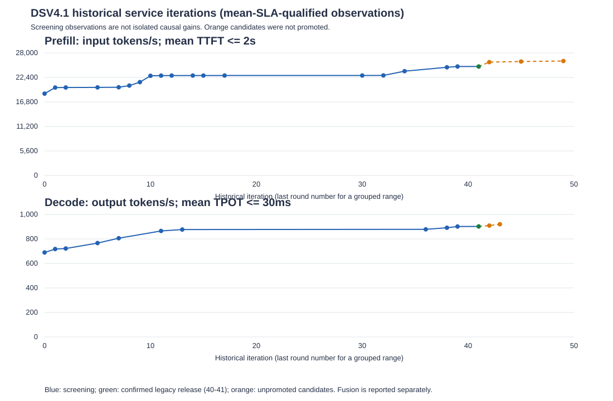

# 优化过程、来源与未晋级结果

来源为本项目保留的prefill/decode逐轮说明与对应服务实验索引，指纹见[data/evidence-manifest.json](data/evidence-manifest.json)。历史筛选、同实例多seed、独立部署和干净重建是不同证据等级。增幅通常相对上一历史突破值，不是每项改动的独立因果贡献。

图中的轮次区间取最后一个编号；蓝线是筛选记录，绿点为原非融合发布确认，橙色为未整配方晋级候选。融合版另见[结项服务表](README.md#服务吞吐结果)，不把它拼入原分支历史曲线。原Baseline回测与早期单次首点不同，本表统一使用正式回测分母。

## Prefill：输入8192、输出1

| 轮次 | 改动 | 具体说明 | 吞吐 tok/s | 历史增幅 | 状态 |
| --- | --- | --- | --- | --- | --- |
| Baseline回测 | 原始配方 | 使用原始配方：序列容量32、token预算4096、DSpark最大投机深度7；作为最终累计收益的正式分母。 | 18,692.26 | — | 正式基准 |
| 1 | 启用 PCIe AllReduce | 启用针对PCIe互联的跨卡AllReduce路径，让TP4推理中的跨卡求和使用该实现，目标是降低通信开销；保留相同模型与精度配置。 | 20,082.12 | 7.44% | 单轮筛选观测 |
| 2 | NUMA/加载路径调整 | 将CPU执行与内存分配绑定到GPU4–7所在的NUMA1，并调整到可运行的权重加载路径，尝试减少跨NUMA访问；加载路径变化本身不能解释为稳态推理加速。 | 20,096.92 | 0.07% | 波动量级，未确认 |
| 5 | DSpark 投机深度7→3 | 每轮最多草拟的token数从7降到3，减少未被接受的草拟计算及验证开销；可能牺牲单轮接受长度，需由实际吞吐判断，主要针对decode。 | 20,119.94 | 0.11% | 单轮筛选观测 |
| 7 | BF16 TwoShot AllReduce | 对适用的BF16消息启用TwoShot两阶段聚合路径，采用分片归约与结果分发；配置6MB消息阈值、row_elems=1024，目标是降低相应跨卡求和开销。 | 20,151.60 | 0.16% | 单轮筛选观测 |
| 8 | 8192-token单请求prefill图分支 | 将token预算4096增至8192，并增加单请求8192-token prefill的CUDA图分支，尝试减少长输入拆分、重复调度和CPU发射开销。 | 20,530.68 | 1.88% | 单轮筛选观测 |
| 9 | i8_a2a 8-bit PCIe传输配置 | 将适用的大消息量化为INT8后，以all-to-all组织跨卡传输和归约，减少通信载荷；引入量化误差，不是将模型权重改为INT8。 | 21,320.78 | 3.85% | 单轮筛选观测 |
| 10 | i8_ring 环形传输配置 | 在INT8压缩传输基础上改用Ring：数据按环形拓扑逐步传递、归约和分发，改变各GPU之间的通信顺序与组织方式。 | 22,766.15 | 6.78% | 单轮筛选观测 |
| 11 | 组合DSpark3、TwoShot与i8_ring | 把分别筛选过的DSpark3、BF16 TwoShot及大消息INT8 Ring组合到同一配方中，由消息类型和阈值选择相应通信路径，观察组合效果。 | 22,808.94 | 0.19% | 单轮筛选观测 |
| 12 | 序列容量32→64；图上限128→256 | 服务内部序列容量32增至64，CUDA图捕获上限128增至256，以容纳更多并发序列和投机验证行数；容量上限不等于实际并发或请求总数。 | 22,827.40 | 0.08% | 波动量级，未确认 |
| 14 | 尝试cohort分组调度 | 加入fill/drain分组调度：先集中完成一组可接纳请求的prefill，再推进该组decode，尝试减少两类工作的交替干扰；该分支未确认收益。 | 22,828.53 | 0.00% | 波动量级，未确认 |
| 15 | cohort稳定性修正 | 修正cohort的请求阶段判断，按已处理prompt进度及异步在途状态识别prefill/decode，避免使用滞后的阶段标记；属于调度正确性修正。 | 22,829.19 | 0.00% | 波动量级，未确认 |
| 17 | 增量算子autotuning | 开启有时间预算的算子autotuning，随调参提交合并选择结果，并导出1371条选择记录；未完成成功的独立冻结选择GPU重建，没有晋级。 | 22,837.71 | 0.04% | 波动量级，未确认 |
| 30 | 并发搜索细化 | 在独立服务实例上重测auto调度，细搜邻近整数并发，并按mean SLA选择最高合格点；属于并发/调度参数搜索，没有新增计算kernel。 | 22,839.37 | 0.01% | 波动量级，未确认 |
| 32 | 恢复固定prefill份额0.4并细搜 | 把prefill_compute_share恢复为固定0.4，再细搜相邻并发，比较固定份额与auto对prefill/decode资源分配的影响；不是限制请求数。 | 22,857.82 | 0.08% | 波动量级，未确认 |
| 34 | MHC投影tile、两级流水与K分片调优 | MHC投影tile由32×8×256改为64×24×64，流水1级改2级，K分片1改4，提高投影并行度；保留FP32权重高低TF32语义。 | 23,826.29 | 4.24% | 单轮筛选观测 |
| 38 | MoE shared-memory carveout调优 | 调整目标MoE kernel的shared-memory carveout偏好，使统一L1/shared空间更多分配给共享内存，配合其资源需求；100%是分区偏好，不是SM占用率。 | 24,713.18 | 3.72% | 单轮筛选观测 |
| 39 | MoE按shape调整网格/寄存器预算；MHC post_pre P8 | 主MoE按容量选择launch网格和寄存器预算：8192容量用phase1/2网格4/4，56/64用3/2，其余保留默认；MHC post_pre56/64默认P4→P8，Sinkhorn20次及精度不变。 | 24,891.68 | 0.72% | 单轮筛选观测 |
| 40–41确认 | 三对独立部署确认＋清洁重建，无新增优化 | 进行三对全新独立部署、质量和mean SLA检查，再用新runtime与空可执行缓存清洁重建，确认收益可复现；没有新增性能优化。 | 24,892.34 | — | 已完整确认并发布 |
| 42 | N64权重布局与大prefill计算域 | 为MoE中间维度576的N64尾块重排量化权重和scale，并为大prefill采用M64计算域；改变存储与计算组织，不改变逻辑权重值。输入收益通过配对确认，输出未通过联合晋级。 | 25,895.48 | 4.03% | 3次部署几何均值，未联合晋级 |
| 43/45 | 自适应容量选择＋FC2 M32 | 按实际有效token数匹配执行容量，避免小批次误用大计算域；在大prefill路径中保留FC1的M64组织，将FC2计算tile改为M32，权衡padding与执行效率。 | 26,035.14 | 0.54% | 3次输入复验平均，未联合晋级 |
| 46–49 | FC1紧凑A布局＋投影分段B调度 | FC1使用紧凑共享内存A布局并调整XOR映射；B计算按gate、up分别处理N片段，只解码当前片段，保持每个累加器K顺序，减少共享加载冲突和等待。 | 26,142.61 | 0.34% | 输入配对增益已确认；整配方未晋级 |

## Decode：输入8192、输出1024

| 轮次 | 改动 | 具体说明 | 吞吐 tok/s | 历史增幅 | 状态 |
| --- | --- | --- | --- | --- | --- |
| Baseline回测 | 原始配方 | 原始配方为内部序列容量32、token预算4096、DSpark最大投机深度7，作为8192输入/1024输出场景的正式比较基准。 | 689.49 | — | 正式基准 |
| 1 | 启用 PCIe AllReduce | 启用针对PCIe互联的跨卡AllReduce路径，让TP4推理中的跨卡求和使用该实现，目标是降低通信开销；保留相同模型与精度配置。 | 717.52 | 4.06% | 单轮筛选观测 |
| 2 | NUMA/加载路径调整 | 将CPU执行与内存分配绑定到GPU4–7所在的NUMA1，并调整到可运行的权重加载路径，尝试减少跨NUMA访问；加载路径变化本身不能解释为稳态推理加速。 | 721.82 | 0.60% | 单轮筛选观测 |
| 5 | DSpark 投机深度7→3 | 每轮最多草拟token数由7降到3，减少未被接受的草拟计算及验证开销；同时可能减少每轮接受token数，实测选择吞吐更好的折中。 | 766.28 | 6.16% | 单轮筛选观测 |
| 7 | BF16 TwoShot AllReduce | 对适用的BF16消息启用TwoShot两阶段聚合路径，采用分片归约与结果分发；配置6MB消息阈值、row_elems=1024，目标是降低相应跨卡求和开销。 | 805.80 | 5.16% | 单轮筛选观测 |
| 11 | 组合DSpark3、TwoShot与i8_ring | 把分别筛选过的DSpark3、BF16 TwoShot及大消息INT8 Ring组合到同一配方中，由消息类型和阈值选择相应通信路径，观察组合效果。 | 865.09 | 7.36% | 单轮筛选观测 |
| 13 | prefill_compute_share 0.4→auto（同实例） | 将固定prefill计算份额0.4改为auto，让调度器自动决定prefill/decode的资源分配。876.60来自同一服务实例筛选，后续独立auto轮未复现，不能当最终发布收益。 | 876.60 | 1.33% | 单轮筛选观测 |
| 36 | 自适应验证cost 1.0→1.25 | 将自适应验证策略中的增量验证成本权重1.0调为1.25，改变草拟候选的验证取舍；没有改变模型权重、计算精度或采样/接受判定规则。该轮小幅变化未证明独立统计收益。 | 878.35 | 0.20% | 单轮筛选观测 |
| 38 | MoE shared-memory carveout调优 | 调整目标MoE kernel的shared-memory carveout偏好，使统一L1/shared空间更多分配给共享内存，配合其资源需求；100%是分区偏好，不是SM占用率。 | 891.28 | 1.47% | 单轮筛选观测 |
| 39 | MoE按shape调整网格/寄存器预算；MHC post_pre P8 | 主MoE按容量选择launch网格和寄存器预算：56/64容量的FC1/FC2用3/2，8192容量用4/4；MHC post_pre56/64默认分组P4→P8，Sinkhorn20次及精度保持。 | 901.29 | 1.12% | 单轮筛选观测 |
| 40–41确认 | 三对独立部署确认＋清洁重建，无新增优化 | 进行三对全新独立部署、质量和mean SLA检查，再用新runtime与空可执行缓存清洁重建，确认收益可复现；没有新增性能优化。 | 901.94 | — | 已完整确认并发布 |
| 42 | N64权重布局与大prefill计算域 | 为MoE的N64尾块重排量化权重和scale，并给大prefill采用M64计算域。8192→1024输出吞吐包含前置prefill及投机验证过程，因此该类改动也可能影响端到端指标；输出配对收益区间跨零，未联合晋级。 | 908.88 | 0.77% | 3次部署几何均值，未联合晋级 |
| 43 | 自适应容量选择＋FC2 M32 | 根据有效token数选择执行容量，避免小批次误用大计算域；大prefill路径保留FC1的M64组织，将FC2计算tile改为M32，权衡padding与执行效率。919.80是单轮服务观察，尚未独立确认。 | 919.80 | 1.20% | 单轮筛选，未晋级 |

## 方法来源与归因

- PCIe AllReduce、BF16 TwoShot、图执行、DSpark均依托当时运行时/B12X已有接口，本项目完成参数选择、覆盖文件适配和服务验证；不把上游组件本身声明为本项目原创。
- NUMA、容量、并发、prefill份额和投机深度属于本项目调度/部署搜索，来源是本项目测量；加载速度变化不算稳态吞吐收益。
- MHC tile/pipeline/K分片、MoE carveout/grid/寄存器预算，以及N64、FC2 M32、FC1 compact-A/StreamB属于本项目算子层实验；最终进入哪份配方由实际overlay与状态决定。
- 网页镜像提供另一套运行时与接口，融合需要适配而非照搬旧运行时文件。原始网页、网页增强组合、融合版和官方vLLM PR实验保持不同身份。
- 外部调研入口包括 [local-inference-lab/rtx6kpro](https://github.com/local-inference-lab/rtx6kpro) 与 [vLLM PR #60762](https://github.com/vllm-project/vllm/pull/60762)。它们是组件/方案背景或被测候选；现有证据不支持为每一轮硬指定一个外部PR来源。

第46–49轮的+0.34%使用该轮直接母本26054.26为分母，而非上一行26035.14。输出925.43的复验mean TPOT未通过，不列为有效发布结果。N64/StreamB的高输入或局部算子收益不等于完整融合配方已晋级。

融合阶段：保留B12X运行时、部署参数、图与通信及MoE/MHC策略；PR60762最小attention overlay和FC1/FC2最小overlay未获联合收益；StreamB候选有质量失败；这些负结果支持本次选型，但不证明其他实现不存在提升空间。
